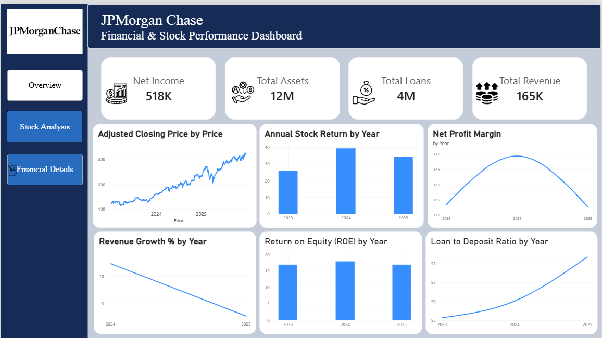
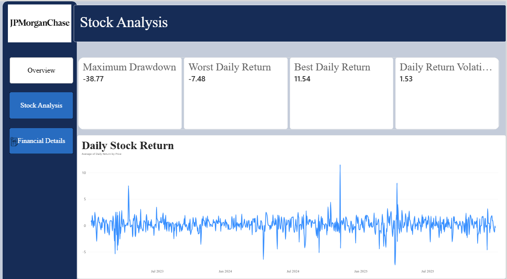
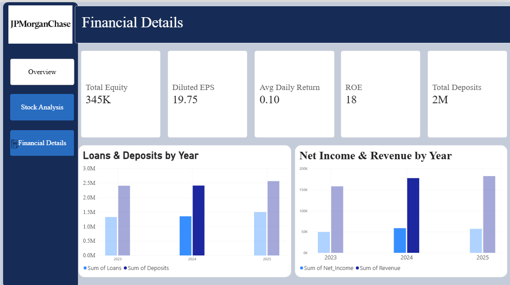

# JP Morgan Financial Analysis Dashboard

A Power BI dashboard exploring JP Morgan's financial performance, profitability, and stock market trends.

## Dashboard Preview

### Overview

### Stock Analysis

### Financial Details

## Key Insights
- Financial performance and profitability indicators
- Historical stock price movements and daily returns
- Stock return volatility and maximum drawdown
- Revenue, net income, loans, and deposits

## Tools Used
- Microsoft Power BI
- DAX
- Financial data analysis

## How to View
Download the `.pbix` file from this repository and open it using Power BI Desktop.
